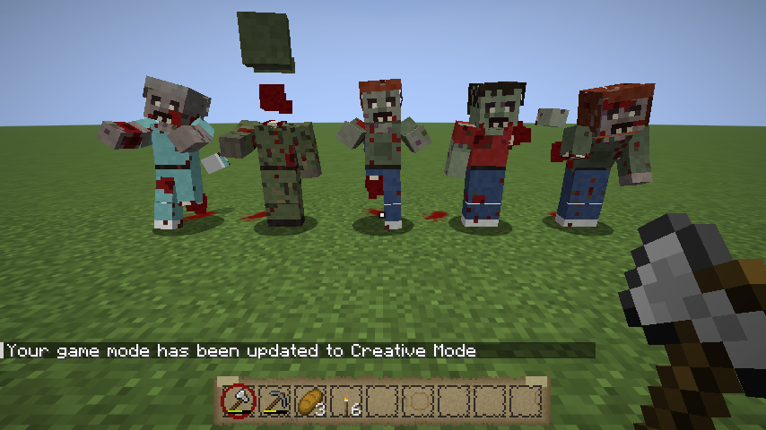
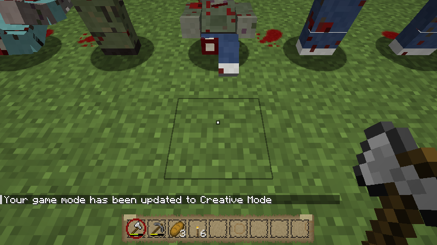
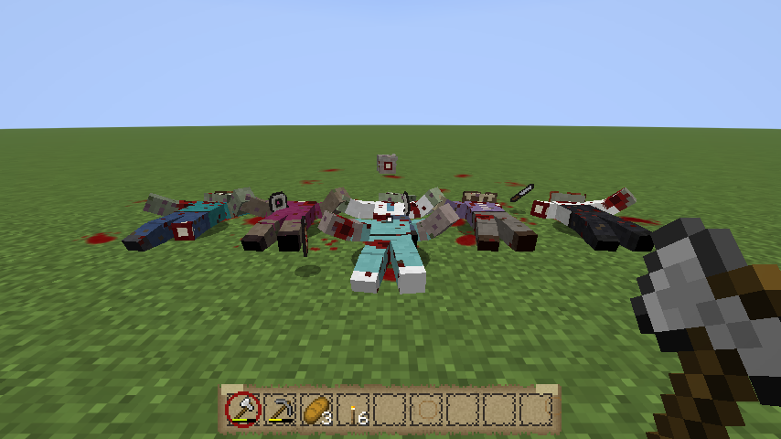
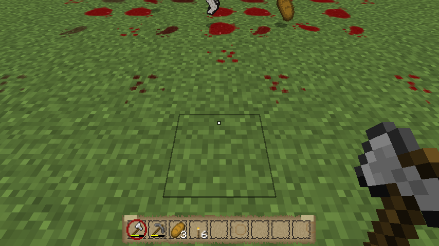
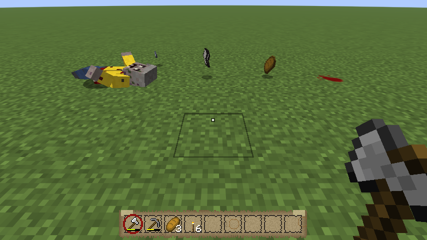
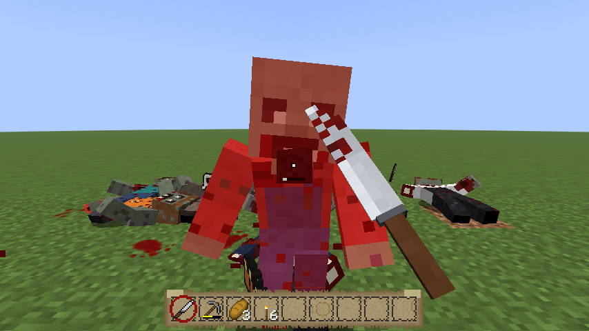

# Combat: walkers that react, weapons you can feel


Walkers are no longer vanilla zombies with a new skin. They have their own model: hips, chest, head,
upper arms, forearms, thighs and shins, all moving separately. Every hit throws them the way the
blow went. Melee weapons are real 3D objects in your hands, each with its own swing. Bare hands
throw left and right punches.

## Walkers
- **24 skins**, from 16 outfits: casual (red, teal), office worker with a tie, Dutch police (cap,
  striped vest), nurse, doctor's coat, construction worker (hi-vis, helmet), student hoodie,
  FC Groningen shirt, jogger, elderly cardigan, soldier (camo, helmet), cyclist in a raincoat, farmer
  in overalls, dress, chef's apron. On top of that: decayed skin tones, patchy or long hair, bites and
  blood. Each walker keeps its skin.
- **Each one walks differently:** five gaits (both arms reaching out, one arm out, arms dangling, a
  limp that lurches over the bad leg, hunched over with the head low), and each has its own head
  tilt. When a walker is after someone, its arms come up towards them.
- **Crawlers:** 8% of walkers have lost their legs and drag themselves along (40% speed, 0.6 blocks
  high: they fit under things and are easy to miss). A walker can also *become* one: see below.


## Hits
Every hit has a direction and a strength. The direction is where the blow pushes, so a bat swung
from your right sends the walker reeling to your left. The strength comes from the weapon (below),
×1.3 on the head.

- **Reaction:** the torso, head and arms are thrown by springs. A hit to the head snaps the head
  round. A body hit folds the walker over and swings its arms out. Then it wobbles back.
- **Stagger:** shoved back and stunned for a moment (0.5–1.2 s, the harder the hit the longer): it
  stops walking and can't attack. Body hits no longer slow walkers afterwards; the stagger replaces that.
- **Knocked down:** a hard enough hit floors it. It falls the way it was hit (left, right, backwards),
  lies there 2.5–5.5 seconds twitching, then gets back up (1.2 s). While it's down it can't move or
  bite, and **every hit on it counts as a head hit**. That's the time to finish it.
- **Legs broken:** a bat hit to the body that floors a walker breaks its legs 15% of the time. It
  crawls from then on. A walker run over by a vehicle always goes down and is always a crawler if
  it survives (it usually doesn't).
- **Crawlers** have their head at your knees: every hit on one counts as a head hit.
- **Death:** a killed walker falls the way the killing blow pushed it, bounces once, and lies there
  for 5 seconds, sinking into the ground in the last second. It no longer flashes red.
- The rules from [phase 1](PHASE1.md) still hold: only the head kills (×4 damage), body hits do half
  damage and never take a walker below 1 health.


## Weapons

| | Style | Swing | Push | Knocks down (body / head) | Swing time |
|---|---|---|---|---|---|
| Bare hands | Punches | left, right, left... | strong for what it is (0.55) | 12%, +25% on a walker still reeling | vanilla |
| Baseball bat | Sweep | two-handed, right to left | 1.0, thrown far to your left | 35% / 50% | 0.6 s |
| Crowbar, hammer, machete, wrench, axes | Chop | raised, then down across | 0.75, a bit to your left | 20% / 35% | 0.5 s |
| Kitchen knife, screwdriver | Stab | a straight thrust | 0.3, barely moves them | 3% / 0% | 0.35 s |
| Anything else | — | vanilla | 0.45 | 8% / 10% | vanilla |

- **3D in hand:** the bat (taped grip, bloody barrel), knife, machete, crowbar (hook and claw),
  hammer, wrench and screwdriver are 3D models in first and third person. The inventory and the
  ground keep the flat icons.
- **The bat is held in both hands**, ready on your shoulder; other players see you wind up and swing
  it through.
- **The hit lands early in the swing:** the swing then follows through. While a weapon recovers
  (the attack cooldown), it barely dips, unlike vanilla, where it drops out of sight.
- **Bare hands:** your arms are fists. Each punch is a straight jab from the shoulder, alternating
  left and right. Two quick punches stagger a walker; a third on a reeling one may put it down.


## Gore
- **Blood flies off every hit:** dark red chunks with real weight, thrown the way the blow went,
  more from the head. Hits splatter the ground under the walker.
- **Limbs come off.** A sharp weapon (machete, axe, sword) to the body has a 22% chance to take
  something: mostly an arm (just the forearm, or the whole arm at the shoulder), sometimes a leg (the
  shin or the whole leg). The limb flies off in the walker's own skin, tumbles, lands with a splat and
  lies there for five minutes (hit it and it skids away). What's left is a ragged stump of meat and
  bone.
- **A walker without a leg is a crawler:** it goes down and drags itself after you, leaving a smear
  on the ground behind it. A walker with no forearms can't break doors or barricades any more.
- **Heads:** a sharp blow to the head that kills has a 40% chance to take the head clean off. The
  body pumps blood from the neck as it drops and lies in a bigger pool.
- **Run over by a car:** 45% to lose a leg, sometimes both. **Explosions** can take any limb.
- **Puddles:** wherever blood lands there's drops, a splatter or a pool, only on bare ground (never
  through blocks). They dry from glossy red to a brown stain and are gone after about twenty minutes,
  sooner in the rain. A corpse leaves a pool spreading out from where it fell. A bleeding survivor
  leaves drops too.








## Admin and testing commands (operators only)
```
/outbreak walker hit <walkers> <yaw> <strength 0-2> [head]   — a hit pushing towards yaw (no damage)
/outbreak walker knockdown <walkers> <yaw>                  — falls over towards yaw, down for 4 s
/outbreak walker stand <walkers>                             — back on its feet at once
/outbreak walker crawler <walkers> <true|false>
/outbreak walker skin <walkers> <0-23>
/outbreak walker info <walkers>                             — skin, crawler, posture, health, position
/outbreak walker corpses <radius>                           — dead walkers still lying around
/outbreak walker sever <walkers> <limb>                      — right_forearm, left_arm, right_leg, left_shin, head...
```
Yaw is Minecraft's: 0 = south, 90 = west, -90 = east.

## How it's made
- **Walkers:** `python3 tools/walkers/make_walkers.py` writes the model
  (`assets/outbreak/models/walker.json`, a tree of boxes) and the 24 skins
  (`textures/entity/walker/`). The game builds the model from the JSON. Hit physics, posture and
  skin are decided on the server and synced. The springs, gait and falls are animated on each
  client, so they're smooth at any ping.
- **Weapons:** `python3 tools/weapons/make_weapons.py` writes the 3D models (`models/item/<weapon>_in_hand.json`),
  the item definitions that pick 3D in the hand and flat elsewhere, and the material sheet they're
  textured from (`textures/item/weapon_materials.png`: wood, steel, chrome, grip tape, blood...).
- **Swings and punches:** `SwingAnimations` (first and third person), keyed by the weapon's style
  (`WeaponStyle`, shared with the server, so how a weapon looks matches what it does).
- **Gore:** the walker model has a stump and a cut end for every joint (`make_walkers.py`); a lost
  limb hides its part and shows the stump, and the severed piece is drawn from the same model, cut end
  showing. Blood puddles are a block (`outbreak:blood`, size × age × facing) made by
  `python3 tools/gore/make_gore.py`; the flying blood is that block's break particles.

## Tests
- Server: `python3 tools/servertest/driver.py . tools/servertest/combat.txt run/combat.log`
  (body hits never kill, a bat floors a walker and it gets back up, a downed walker dies to one hit,
  the corpse stays 5 seconds, fists shove, a crawler is low).
- Client: `WalkerClientTest` (skins, a herd, a head hit frame by frame, a shove, falling each way,
  down, getting up, a crawler, a kill and the corpse) and `CombatClientTest` (the bat to the body
  and the head, punches, each swing in first person, the bat and hammer in third person), and
  `AnimationClientTest`: every animation frame by frame, to check things line up (each swing and
  punch in first person and from the front and back in third person, and a walker walking, biting,
  hit, falling, down, getting up and crawling, side-on), and `GoreClientTest` (blood particles, five
  walkers each losing something, the pieces, a headless corpse in its pool, puddles drying, a
  crawler's trail, a machete hit).

## Not yet
Stomping, grabbing and shoving with a key, sounds for each weapon, blood on walls. (Guns came in
phase 6: see [PHASE6.md](PHASE6.md).)
