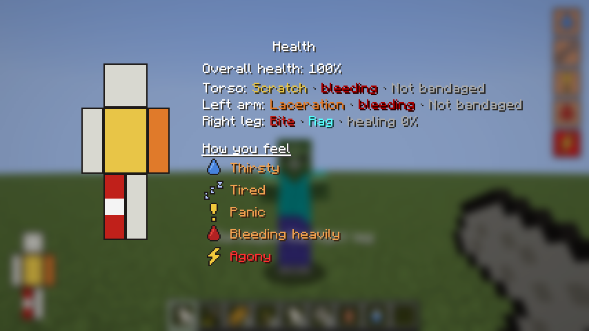

# Phase 2: body and HUD




## The HUD
- **Removed:** vanilla hearts, hunger bar, armour bar and XP bar.
- **Moodles (top right):** an icon appears when something is wrong. The tile colour shows how bad it is:
  yellow, orange, red, then flashing red at level 4.

  | Moodle | From | Levels |
  |---|---|---|
  | Hungry | food bar ≤ 14 / 10 / 6 / 2 | Peckish → Starving |
  | Thirsty | thirst ≥ 0.4 / 0.6 / 0.8 / 0.95 | Slightly thirsty → Dying of thirst |
  | Tired | fatigue ≥ 0.5 / 0.7 / 0.85 / 0.95 | Drowsy → Can barely stay awake |
  | Panic | walkers that see or chase you, being hurt | Slight panic → Extreme panic |
  | Bleeding | number of bleeding wounds | Bleeding → Bleeding out |
  | Pain | total of all wounds | Minor pain → Agony |
  | Sick | infection or food poisoning (they look the same!) | Queasy → Agonizing fever |
  | Injured | health ≤ 16 / 12 / 8 / 4 | Minor injuries → Critically injured |

- **Body doll (bottom left):**
  - The colour shows the wound: yellow scratch, orange laceration, red bite. It flashes dark red while bleeding.
  - A white band means bandaged, brownish once the bandage is dirty.
  - A green outline means the wound is infected.
- **Health panel (H):** a big doll, every wound in words, overall health, and how you feel. The game
  keeps running while it's open.

## Wounds
Each walker hit that gets through leaves a wound on a random body part:

| Wound | Chance per hit | Knox infection | Bleeding | Heals in |
|---|---|---|---|---|
| Scratch | 55% | 7% | ½ heart per 20 s, stops by itself after 20 s | 3 min |
| Laceration | 30% | 25% | ½ heart per 12 s until bandaged | 8 min |
| Bite | 15% | **100%** | ½ heart per 8 s until bandaged | 12 min |

- **Body part odds:** head 10%, torso 25%, each arm 20%, each leg 12–13%.
- **Hit again on the same part:** the worse wound stays, and an old wound reopens.
- **Leg wounds** (laceration or bite) make you limp.
- **Healing speed:**
  - With nothing on it, ×0.5. A bleeding wound doesn't heal at all.
  - Rag ×1, bandage ×1.5, dirty bandage ×0.5.
  - Infected wounds don't heal.
  - Starving or very thirsty slows healing down even more.
- **Health only comes back on its own** (½ heart per 30 s) when you're not bleeding, are fed (food ≥ 10),
  aren't very thirsty and aren't sick. Vanilla regeneration from a full food bar is switched off.

## First aid
Hold right-click with the item. It treats the wound that needs it most: bleeding first, then dirty
bandages, then anything unbandaged. If there's nothing to treat, the item isn't used up.

| Item | How to get it | What it does |
|---|---|---|
| Rag | 1 wool → 3 rags | Stops bleeding. Not sterile: 10% chance of a wound infection unless the wound was disinfected first. |
| Bandage | Smelt a rag (or cook it on a campfire) | Stops bleeding, heals 1.5× faster, never infects. |
| Disinfectant | Glass bottle + 2 sugar + potato (home-made alcohol) | Cures a wound infection and protects the wound from infection. |

**Bandages get dirty** after 3 minutes and need changing. A dirty bandage left on for 2 more minutes infects the wound.

## The Knox infection
- **You don't know you have it.** It's hidden from the client and the HUD.
- **Course of the infection** (it kills in about 24 minutes, 1.2 in-game days):
  - First 20%: nothing at all.
  - Then: Queasy → Nauseous (hunger effect, waves of nausea) → Fever (also slowness and weakness)
    → Agonizing fever (you lose health).
  - Then you die ("succumbed to the infection") and rise as a walker 30 seconds later.
- **There's no cure.** Amputation, the TWD way out, is planned for later.
- **Food poisoning looks the same at first:** drinking unboiled water (a water bottle) gives a 15% chance
  of 90 seconds of "Queasy"/"Nauseous". So a sick feeling doesn't always mean you're done for.

## Thirst and fatigue
- **Thirst:**
  - Goes from 0 to 1 in 40 minutes (faster when sprinting).
  - At 1 you lose ½ heart every 10 s ("died of thirst").
  - Drinking: water bottle −0.35 (risk of food poisoning), boiled water −0.4 (safe), milk −0.4,
    stews −0.2, honey and melon −0.1, berries and apples a little.
  - **Boiled water:** smelt a water bottle, or cook it on a campfire.
- **Fatigue:**
  - Goes from 0 to 1 over 20 minutes awake (twice as fast when sprinting).
  - From 0.85: slowness and mining fatigue.
  - Sleeping through the night resets it, but you wake up a bit thirsty.
  - Walkers nearby still stop you from sleeping.
- **Panic:**
  - Rises with every walker that sees or chases you, and when you get hurt.
  - Slowly fades when you're safe.
  - It has no effect yet (planned: shaky aim with guns).

## Other effects
- **Pain** ≥ 0.6: mining fatigue.
- **Sick** ≥ 0.35: hunger effect and nausea waves. ≥ 0.6: slowness and weakness. ≥ 0.85: lose health.
- **Walker damage** lowered from 4 to 3. The wounds are the real danger now.

## Admin and testing commands (operators only)
```
/outbreak status <player>                      — everything, including the hidden infection
/outbreak wound <player> <part> <type>         — e.g. left_arm laceration
/outbreak infect <player> [progress 0-0.99]
/outbreak set <player> thirst|fatigue|panic <0-1>
/outbreak cure <player>                        — reset the body completely
```

## Tests
- Server: `python3 tools/servertest/driver.py . tools/servertest/phase2.txt run/phase2.log`
- Client with screenshots: `xvfb-run -a ./gradlew runClientGameTest`. On Linux without a GPU, also set
  `SDL_VIDEO_FORCE_EGL=1`. Screenshots end up in `build/run/clientGameTest/screenshots/`.
