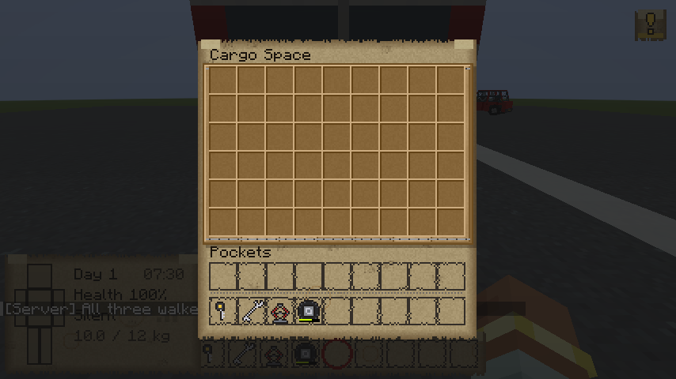

# Phase 4: vehicles


Five vehicles: a **bicycle**, a **scooter**, a **hatchback**, a **sedan** and a **van**. Like in
Project Zomboid, each one is a set of parts that wear out, and most of the ones you find need work
before they'll drive.

| | Seats | Top speed | Tank | Storage | Noise (idle / driving) |
|---|---|---|---|---|---|
| Bicycle | 1 | 26 km/h | — | — | — / almost silent |
| Scooter | 2 | 40 km/h | 6 L | — | 10 / 22 blocks |
| Hatchback | 4 | 61 km/h | 40 L | trunk, 18 slots | 16 / 28 blocks |
| Sedan | 4 | 68 km/h | 50 L | trunk, 27 slots | 16 / 28 blocks |
| Van | 2 | 54 km/h | 70 L | cargo space, 54 slots | 18 / 32 blocks |

## Driving
- **Get in:** right-click a vehicle. The first one in drives (on the left: they drive on the right in
  the Netherlands). **Shift** gets you out on your side.
- **Bicycles:** put one down by right-clicking the ground with it; punch it to pick it back up.
- **W / S:** accelerate, brake, reverse. **A / D:** steer. **Space:** handbrake.
- **R:** start or stop the engine. **G:** horn (a bell on a bicycle).
- **The dashboard** (bottom right) shows your speed, the fuel gauge, the engine, the battery and a
  diagram of the tires.
- **Off the road**, cars are much slower (65% of top speed); bicycles and scooters less so. Roads
  are Arnis's asphalt, lane markings, parking lots, and the red bicycle paths.
- **Crashing** into a wall at speed damages the body, then the engine and windows, then the people
  inside. On two wheels you're thrown off.
- **Water** kills the engine.
- **Walkers in the road** get run over: the one body hit that kills a walker. Each one dents the body
  and slows you down; on a bicycle or scooter hitting one at speed throws you off.


## Parts
Sneak-right-click a vehicle (or right-click it holding a part) to work on it.


| Part | What it does | Changing it |
|---|---|---|
| **Tires** (one per wheel) | A worn tire is a bit slower; a flat one is much slower and pulls the car to its side; a missing one means you're not going anywhere. They wear as you drive. | Car tires: a **jack** and a **wrench**. Scooter: a wrench. Bicycle: by hand. |
| **Battery** | Needed to start the engine (each try uses some charge) and for the horn and alarm. A running engine charges it. | A **wrench**. |
| **Engine** (0–100%) | Below 50% it may not start the first time, below 20% it can stall. It sets the top speed and acceleration. | **Repair engine**: engine parts and a wrench, +15% each. A burnt-out wreck can't be fixed. |
| **Windows** | While they hold, walkers hitting you inside the car hit the windows instead (about a dozen hits). Broken windows let walkers reach you, and let anyone into a locked car. | **Fix windows**: 2 glass panes and a screwdriver, +50%. |
| **Body** | Takes the knocks from crashes and walkers. At 0% the vehicle is a wreck. | — |
| **Fuel** | About half a litre a minute idling, plus 0.25 (scooter) to 1.1 (van) litres per 100 blocks driven. | See below. |

## Fuel
- **Pour** a jerrycan in: right-click the vehicle holding it.
- **Siphon** fuel out: right-click the vehicle holding a **hose**, with a jerrycan in your inventory.
  Wrecks often still have some in the tank.
- A **jerrycan** holds 20 litres, and petrol is heavy: a full one weighs about 9 kg.
- Gas station pumps come later, with the power grid (phase 6).

## Keys, locks and hotwiring
- Each car and scooter has its own **key** ("Key: Red Hatchback"). With it in your inventory you can
  start the engine. Right-click the vehicle with the key in hand to unlock it; sneak-right-click to
  lock it.
- A **locked** car won't let you in or open its trunk without the key, unless a window is broken.
  Hit a window to break it (3 hits). It's loud, and it may set off the alarm.
- **Hotwiring:** sit in the driver's seat holding a **screwdriver** and press R. Each try has a 40%
  chance and wears the screwdriver; a failed try may set off the alarm. Once hotwired, it stays
  hotwired.
- **Car alarms** (a quarter of parked cars): 30 seconds of noise that carries 72 blocks. A free herd
  magnet.

## Parked cars and wrecks
The first time a chunk loads, if it has enough road on it (Arnis paves roads with grey concrete
powder and cyan terracotta, parking lots with black concrete), there's a 35% chance of a vehicle
parked along the road. Red bicycle paths may get a bicycle (20%).

| | Chance | Condition |
|---|---|---|
| **Abandoned** | 60% | Worn tires (some flat or missing), a battery that may be dead, an engine at 15–100%, 0–60% fuel, often locked, some with an alarm. Things in the trunk. |
| **Wreck** | 40% | Burnt out: won't drive again. Missing tires, no windows, maybe a dead battery and some fuel to siphon, maybe things in the trunk. |

Where's the key of an abandoned car? In the ignition (25%), in the trunk (15%), in the pocket of a
walker standing nearby (25%), or gone (35%): hotwire it.

| Type | Chance |
|---|---|
| Hatchback | 35% |
| Sedan | 30% |
| Van | 15% |
| Scooter | 20% |

## Items

| Item | Weight | Found in | Recipe |
|---|---|---|---|
| Car tire | 6 kg | trunks | — |
| Bike tire | 0.8 kg | workshops | — |
| Car battery | 8 kg | workshops | — |
| Engine parts | 1 kg | toolboxes, workshops, trunks | 4 iron ingots, 4 iron nuggets, redstone |
| Jerrycan | 1 kg + fuel | workshops, trunks | 5 iron ingots, 2 iron nuggets |
| Hose | 0.5 kg | workshops | 6 dried kelp, 2 string |
| Wrench | 1 kg | toolboxes, workshops, trunks | 2 iron ingots, 2 iron nuggets |
| Screwdriver | 0.2 kg | toolboxes, workshops | iron ingot, 2 sticks |
| Car jack | 3 kg | workshops, trunks | 3 iron ingots, 3 iron nuggets |
| Bicycle | 10 kg | red bicycle paths | 3 iron ingots, leather, 2 bike tires |

The wrench and screwdriver are also (weak) weapons. Creative mode has spawn items for every vehicle
(in good shape, half a tank, with the key).




## Admin and testing commands (operators only)
```
/outbreak vehicle spawn <type> <new|abandoned|wreck> [give key]
/outbreak vehicle info                    — the nearest vehicle, every part
/outbreak vehicle set <fuel|engine|windows|body|battery|locked> <value>
/outbreak vehicle engine | horn           — as the driver (for test players)
/outbreak vehicle start                   — start the engine only if it is off (for tests)
/outbreak vehicle populate <radius>       — run the road spawner on the chunks around you (100% chance)
```

## How it's made
- **Models and textures** are generated by `python3 tools/vehicles/make_vehicles.py`: each vehicle is
  a tree of boxes (`assets/outbreak/vehicles/<type>.json`) with a painted texture per colour, plus a
  burnt-out one. The glass is see-through, so you can see who's inside.
- **Driving** runs on the driver's own client, like a boat, so it's smooth at any ping; the server
  keeps fuel, damage, keys, noise and everything else.

## Tests
- Server: `python3 tools/servertest/driver.py . tools/servertest/phase4.txt run/phase4.log`
  (pouring and siphoning, no key, hotwiring, a walker hearing the engine and clawing through the
  windows to the driver, a locked car and a broken window, a wreck, the road spawner, picking up a
  bicycle).
- Client: `VehicleClientTest` (every vehicle, the driver's seat, driving through three walkers, the
  mechanics page, the van's cargo space, the bicycle).

## Good to know
- Log out while sitting in a vehicle and it leaves with you (like a boat in vanilla), and comes back
  when you do.

## Not yet
Boats, headlights, gas station pumps (with the power grid), jump-starting, car seats as storage,
skills for hotwiring and repairs, and vehicle models made with GeckoLib.
