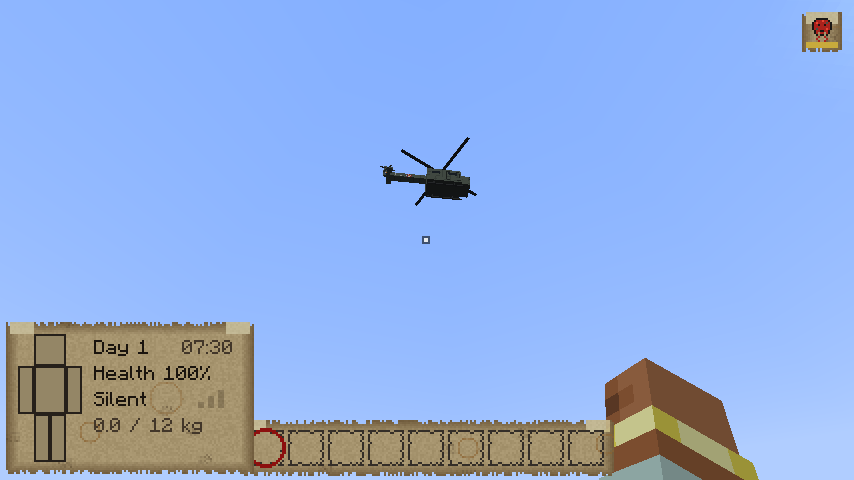
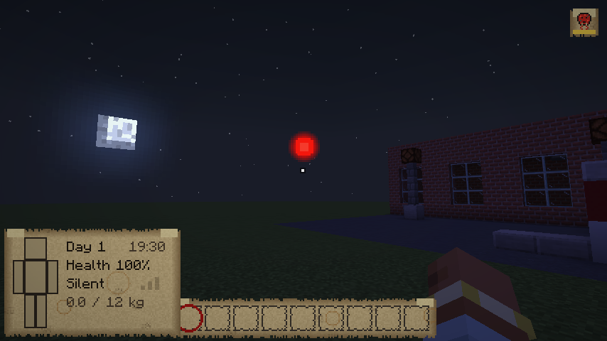
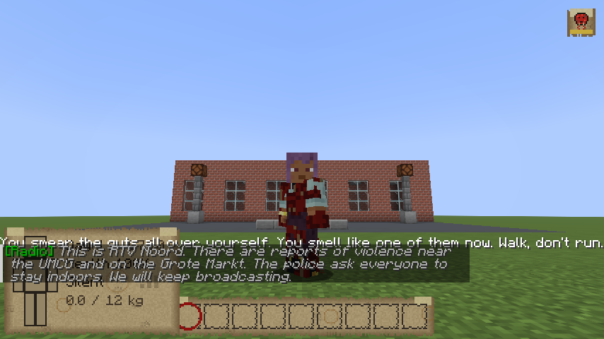
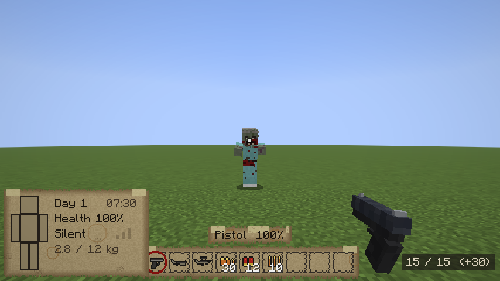
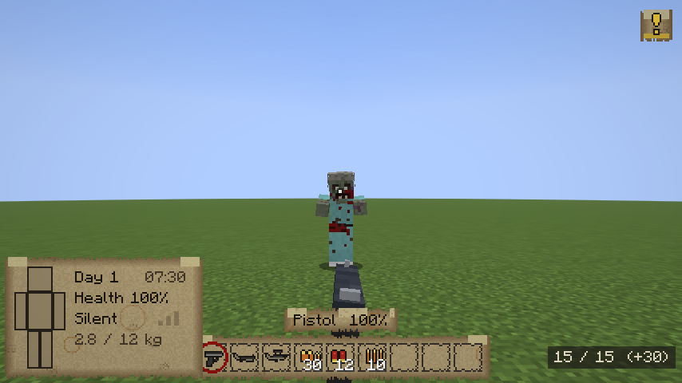
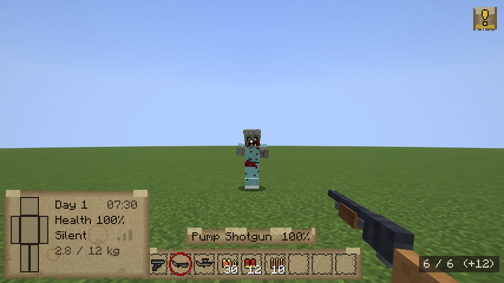
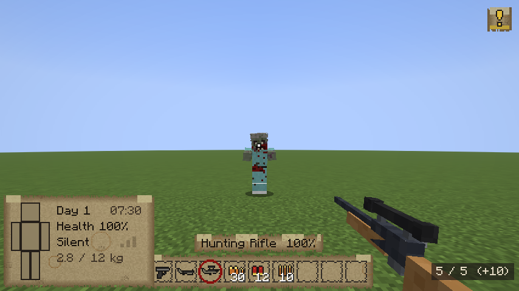
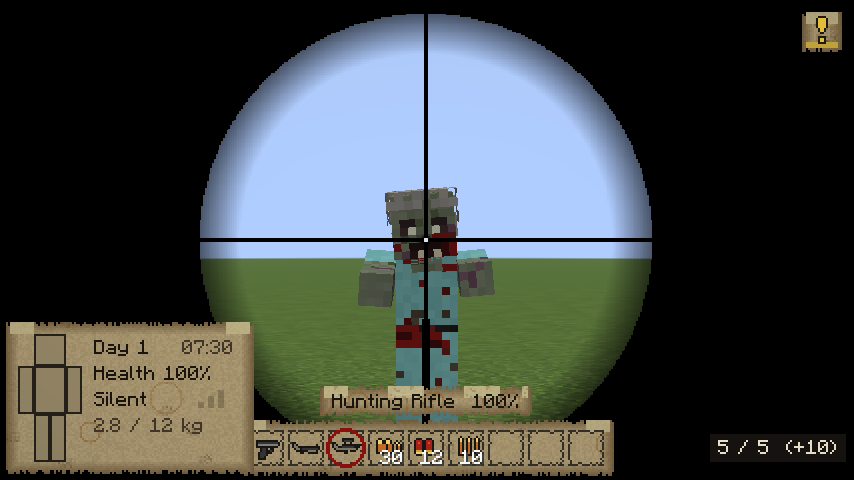
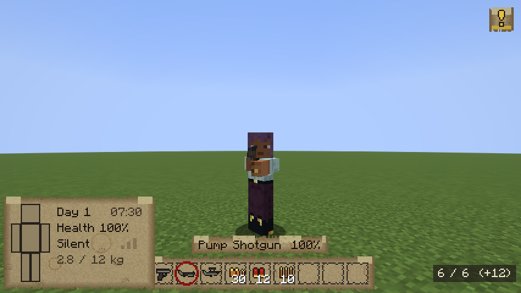
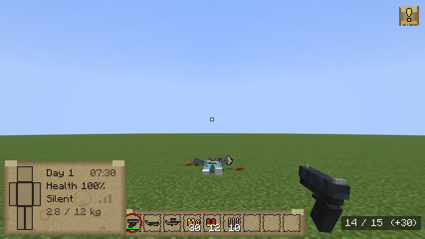

# Phase 6: the world winds down

The outbreak goes on without you. For a few days the outside world still talks: NL-Alerts on your
phone, the emergency broadcast on the radio. Then the water stops, the power goes, and the city goes
dark.

## The timeline
- **The days count** from the outbreak (day 1 is the first day; later scenarios start later).
- **The water** and **the power** each go off on a random day and hour in the range the world's
  sandbox settings give, picked when the world starts:

  | Setting | Goes off |
  |---|---|
  | Already off | from the start |
  | Days 2-6 | early (the Nightmare preset) |
  | Days 7-21 | the default (Apocalypse) |
  | Days 21-60 | late (Survivor) |
  | Never | (Builder) |

  The six-months-later scenario starts with both long gone. Change a setting later and a new day is
  picked.


## The power goes
- **The city goes dark.** With a bang somewhere (a transformer going), every electric light Arnis
  built goes out: the street lamps, the ceiling lights in houses and shops, the lights in tunnels. The
  chunks around you go dark at once, the rest of the city as you get there. Lanterns, torches and
  candles keep burning: they're all the light there is now.
- **The fuel pumps stop.** Until then, Arnis's petrol stations work: right-click a pump's nozzle with
  a jerrycan to fill it, or with your car parked next to the pump to fill the tank. Each pump only has
  so much left in it (less in the later scenarios), and it's loud.


## The water goes
- **Taps** (the sinks in Arnis's houses): while the water runs, fill a bottle with clean tap water or
  a bucket, or drink straight from the tap. Then they cough, spit and run dry. From then on it's rain
  in the cauldrons, and canal water you boil first (raw water can make you sick).

## Broadcasts
- **NL-Alerts:** everyone's phone goes off at the same moment (the alarm tone, the message at the top
  of the screen): the incident at the UMCG, people attacking others, the army closing the roads, the
  evacuation centre at the Euroborg, and then that it's closed. A street full of phones going off is
  noise the dead hear.
- **The radio** (RTV Noord's emergency broadcast): a new message each day for the first week, repeated
  every few hours. Then a recorded message from the Veiligheidsregio, slower each day. Then only
  static.
- **A portable radio** (found in houses, workshops, cabinets and car trunks) runs on batteries (an
  hour of listening a set; the durability bar). Right-click to switch it on or off; flat batteries are
  swapped for new ones from your pockets. A **car radio** plays while the engine runs. Either is heard
  by anything nearby.


## Out of your hands (meta events)
- **The helicopter.** Once, on a day in the first two weeks, an army helicopter comes in low, finds
  one of you and circles overhead for a minute, as if it's looking for something. Then it flies off.
  You hear it a long way off. So does every walker: they all follow it, and it leaves them at your
  door.
- **Gunfights in the distance:** a burst of shots somewhere far off (often in the first days, rarely
  later, then never). The dead near it go to look, and so might you.
- **Flares over the Euroborg:** on the nights the evacuation centre still holds out, a red flare goes
  up over the stadium, seen from all over the city.
- **Herds on the move.** Every couple of minutes some of the herds around you set off across the
  city, a hundred blocks or so, all drifting the same way; the way changes every day. The street you
  cleared won't stay clear.




## Walking among them
- **Walker guts:** kill a walker with a blade (machete, axe, sword) and you may get its guts. Hold
  right-click to smear them all over yourself: the dead take you for one of them and walk right past
  you (the moodle shows you're covered, and everyone sees it).
- It doesn't last: **rain** or water washes it off, **running** shakes it off, and the moment you
  **attack** one of them, they know. Otherwise it dries and flakes off after a quarter of an hour.



## Guns
Rare (this is the Netherlands: a police pistol in a cabinet, a hunter's rifle in a shed, a shotgun in
a car boot), and loud: every shot is heard streets away, and the dead come.

| | Holds | Damage | Spread (hip / aimed) | Between shots | Heard from | |
|---|---|---|---|---|---|---|
| Pistol | 15 × 9mm | 6 | 2.5° / 0.6° | 0.3 s | 64 blocks | quick, a magazine at a time (2 s) |
| Pump shotgun | 6 shells | 8 × 3 | 6° / 4.5° | 0.9 s (the pump) | 80 blocks | loaded a shell at a time; can take a head off |
| Hunting rifle | 5 rounds | 16 | 3.5° / 0.1° | 1.3 s (the bolt) | 112 blocks | a scope; reaches 160 blocks |

- **Left-click** fires. **Hold right-click** to aim: tighter, zoomed in, the gun up at your eye; the
  rifle you look through its scope. **R** reloads from the ammunition in your pockets (and starts the
  engine when you're in a car, as before). Running makes you miss.
- **It's the same fight:** a body shot staggers a walker but never kills it; a head shot does four
  times the damage. A shotgun or a rifle round to the head can take it off.
- Each shot kicks the barrel up. Bullets break glass. Out of rounds, the gun clicks.
- The counter bottom right: rounds in the gun / what it holds (+ what you carry).









## Items
| Item | |
|---|---|
| Tap water | From a tap while the water runs: as safe as boiled water. |
| Portable radio | Hear the broadcasts. Runs on batteries. |
| Batteries | New batteries for the radio. |
| Walker guts | From a walker killed with a blade: smear them on to walk among the dead. |
| Pistol, pump shotgun, hunting rifle | See Guns. |
| 9mm rounds, shotgun shells, rifle rounds | Ammunition. |

## Admin and testing commands (operators only)
```
/outbreak timeline                     — the day, when the water and power go, what's on the radio
/outbreak timeline power|water on|off  — cut it now, or bring it back for good (dead lights stay dead)
/outbreak timeline alert <0-4>         — send an NL-Alert to everyone
/outbreak timeline radio               — tune in: what you'd hear now
/outbreak timeline darken <radius>     — put the lights out in the chunks around you now
/outbreak sandbox set water|power <already_off|early|normal|late|never>
/outbreak event helicopter             — the helicopter comes for you now
/outbreak event gunfight               — a gunfight in the distance
/outbreak event flare                  — a flare over the Euroborg
/outbreak event migrate                — send the herds around you on their way now
/outbreak gun fire [aimed] | reload    — fire or reload the gun you hold (for testing)
```

## How it's made
- `Timeline` keeps the days the water and power go (world saved data) and checks the clock every
  second. `PowerGrid` puts out the lights: glowstone and sea lanterns become a dead light fixture, lit
  redstone lamps go out; each chunk only once (it's marked), a few chunks per tick.
- `FuelPumps` recognises Arnis's pumps (a nozzle on a coloured pump head on white concrete) and keeps
  how much each has left. `Taps` are the empty cauldrons. `Broadcasts` holds the schedule.
- `MetaEvents` picks the helicopter's day when the world starts and rolls for gunfights each hour; the
  helicopter only flies where the world is running (it comes in from the edge of it). Flares are drawn
  on each client in the Euroborg's direction, within view distance. Migrating herds: the leader of
  each herd walks a stretch at a time (`MigrateGoal`), the herd follows the leader.
- **Guns** (`Guns`, `GunType`, `GunItem`): the client sends "fire" (aimed or not) or "reload"; the
  server checks the gun and its rounds (kept on the gun), traces each bullet from your eye with the
  gun's spread and deals the damage as a hit by you. The models are made by
  `python3 tools/weapons/make_weapons.py` (held along the arm, so they point ahead when you aim), the
  icons, the scope and the sounds (each shot, the click, the reload, the pump) by `make_world.py`.
- `Camouflage` keeps until when you're covered (synced to everyone, for the overlay and the moodle);
  walkers can't see you while you are.
- The dead light, the radio, batteries, tap water, walker guts and their overlay, the helicopter (a box
  model and texture, like the vehicles), the flare and the sounds (the NL-Alert tone, radio static,
  the pump, the transformer, the rotors, distant gunfire) are made by
  `python3 tools/world/make_world.py`.

## Tests
- Server: `python3 tools/servertest/driver.py . tools/servertest/phase6.txt run/phase6.log` (the
  lights going out and the lantern staying lit, a tap filling a bottle and then running dry, a pump
  filling a jerrycan and a car's tank and then dying with the power, the radio switching on, an alert,
  a new power day after changing the setting, a walker leaving a survivor covered in guts alone until
  they run, herds setting off across the map, the helicopter circling and a walker following it in).
- Server: `python3 tools/servertest/driver.py . tools/servertest/guns.txt run/guns.log` (a head shot
  kills, a body shot doesn't, rounds counting down, reloading a magazine and a shotgun shell by shell,
  shooting out a window, a walker 60 blocks away coming to the sound of the rifle).
- Client: `WorldClientTest` (a street at night, then without power; an NL-Alert; the radio; a dead
  pump; covered in guts; the helicopter overhead; a flare over the Euroborg; the sandbox settings) and
  `GunClientTest` (each gun held and aimed, the scope, third person, a head shot).

## Not yet
Silencers and other attachments, more guns (the police's, the army's at the Euroborg), crafting
ammunition, generators to keep your own power on, TVs, rain filling barrels.
