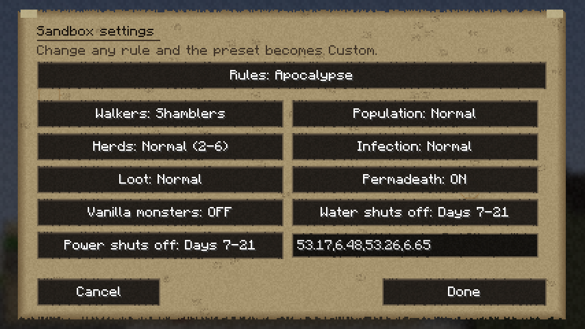
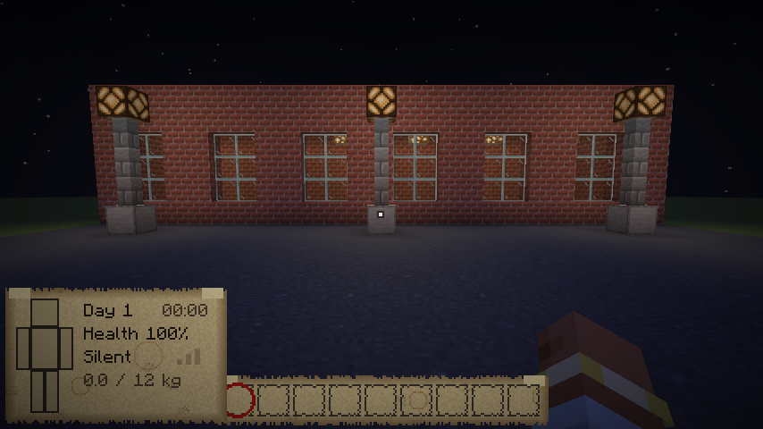
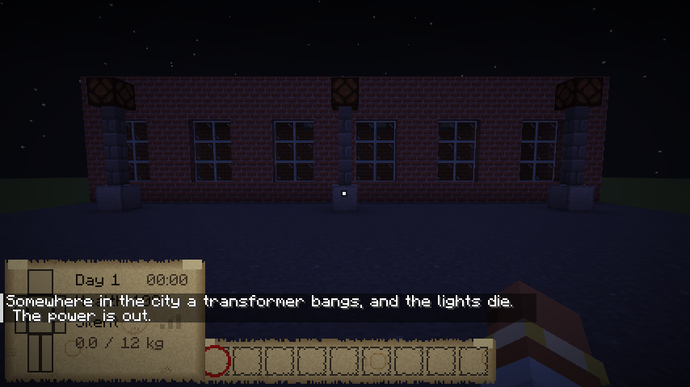
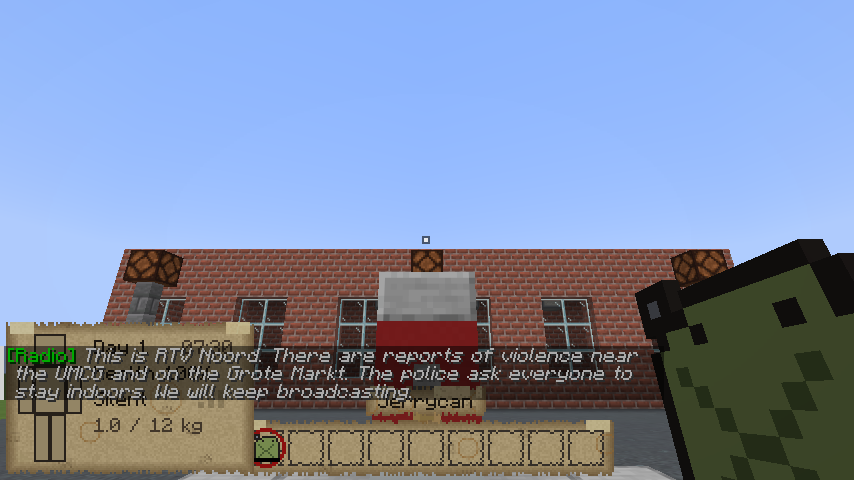
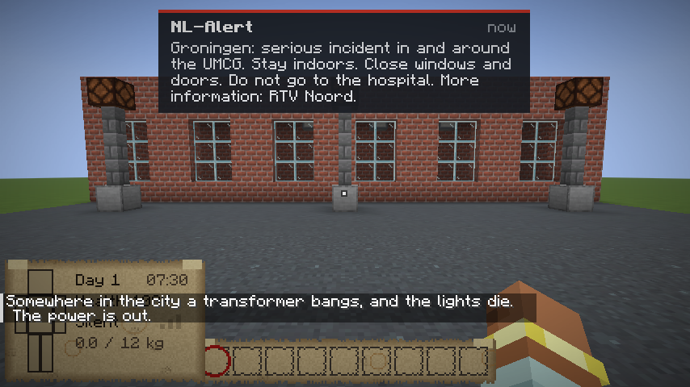
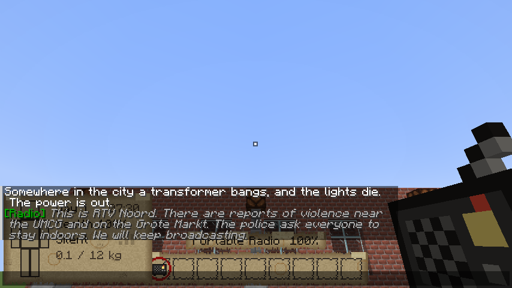

# Phase 6: the world winds down

The outbreak goes on without you. For a few days the outside world still talks: NL-Alerts on your
phone, the emergency broadcast on the radio. Then the water stops, the power goes, and the city goes
dark.

## The timeline
- **The days count** from the outbreak (day 1 is the first day; later scenarios start later).
- **The water** and **the power** each go off on a random day and hour in the range the world's
  sandbox settings give, picked when the world starts:

  | Setting | Goes off |
  |---|---|
  | Already off | from the start |
  | Days 2-6 | early (the Nightmare preset) |
  | Days 7-21 | the default (Apocalypse) |
  | Days 21-60 | late (Survivor) |
  | Never | (Builder) |

  The six-months-later scenario starts with both long gone. Change a setting later and a new day is
  picked.



## The power goes
- **The city goes dark.** With a bang somewhere (a transformer going), every electric light Arnis
  built goes out: the street lamps, the ceiling lights in houses and shops, the lights in tunnels. The
  chunks around you go dark at once, the rest of the city as you get there. Lanterns, torches and
  candles keep burning: they're all the light there is now.
- **The fuel pumps stop.** Until then, Arnis's petrol stations work: right-click a pump's nozzle with
  a jerrycan to fill it, or with your car parked next to the pump to fill the tank. Each pump only has
  so much left in it (less in the later scenarios), and it's loud.





## The water goes
- **Taps** (the sinks in Arnis's houses): while the water runs, fill a bottle with clean tap water or
  a bucket, or drink straight from the tap. Then they cough, spit and run dry. From then on it's rain
  in the cauldrons, and canal water you boil first (raw water can make you sick).

## Broadcasts
- **NL-Alerts:** everyone's phone goes off at the same moment (the alarm tone, the message at the top
  of the screen): the incident at the UMCG, people attacking others, the army closing the roads, the
  evacuation centre at the Euroborg, and then that it's closed. A street full of phones going off is
  noise the dead hear.
- **The radio** (RTV Noord's emergency broadcast): a new message each day for the first week, repeated
  every few hours. Then a recorded message from the Veiligheidsregio, slower each day. Then only
  static.
- **A portable radio** (found in houses, workshops, cabinets and car trunks) runs on batteries (an
  hour of listening a set; the durability bar). Right-click to switch it on or off; flat batteries are
  swapped for new ones from your pockets. A **car radio** plays while the engine runs. Either is heard
  by anything nearby.




## Items
| Item | |
|---|---|
| Tap water | From a tap while the water runs: as safe as boiled water. |
| Portable radio | Hear the broadcasts. Runs on batteries. |
| Batteries | New batteries for the radio. |

## Admin and testing commands (operators only)
```
/outbreak timeline                     — the day, when the water and power go, what's on the radio
/outbreak timeline power|water on|off  — cut it now, or bring it back for good (dead lights stay dead)
/outbreak timeline alert <0-4>         — send an NL-Alert to everyone
/outbreak timeline radio               — tune in: what you'd hear now
/outbreak timeline darken <radius>     — put the lights out in the chunks around you now
/outbreak sandbox set water|power <already_off|early|normal|late|never>
```

## How it's made
- `Timeline` keeps the days the water and power go (world saved data) and checks the clock every
  second. `PowerGrid` puts out the lights: glowstone and sea lanterns become a dead light fixture, lit
  redstone lamps go out; each chunk only once (it's marked), a few chunks per tick.
- `FuelPumps` recognises Arnis's pumps (a nozzle on a coloured pump head on white concrete) and keeps
  how much each has left. `Taps` are the empty cauldrons. `Broadcasts` holds the schedule.
- The dead light, the radio, batteries, tap water and the sounds (the NL-Alert tone, radio static, the
  pump, the transformer) are made by `python3 tools/world/make_world.py`.

## Tests
- Server: `python3 tools/servertest/driver.py . tools/servertest/phase6.txt run/phase6.log` (the
  lights going out and the lantern staying lit, a tap filling a bottle and then running dry, a pump
  filling a jerrycan and a car's tank and then dying with the power, the radio switching on, an alert,
  a new power day after changing the setting).
- Client: `WorldClientTest` (a street at night, then without power; an NL-Alert; the radio; a dead
  pump; the sandbox settings).

## Still to come in this phase
Meta events (a helicopter flying over and drawing the herds, distant gunshots, a flare over the
Euroborg), herds that migrate across the city, smearing walker guts on yourself to walk among them,
and guns.
