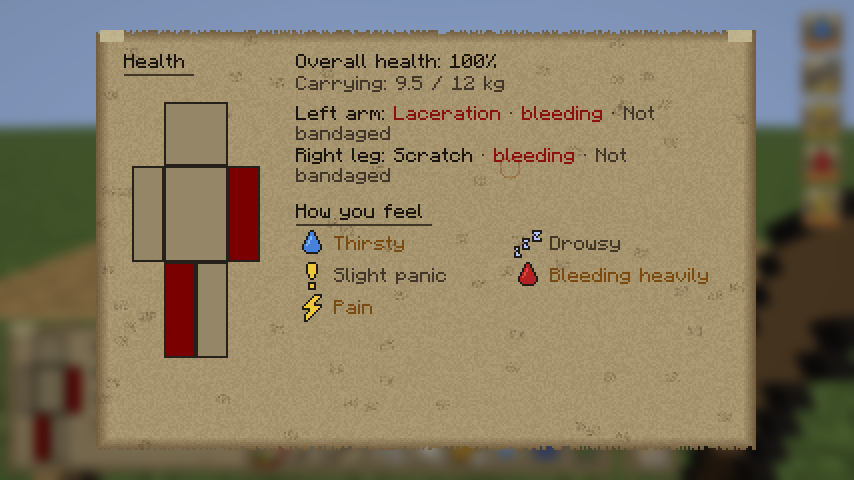
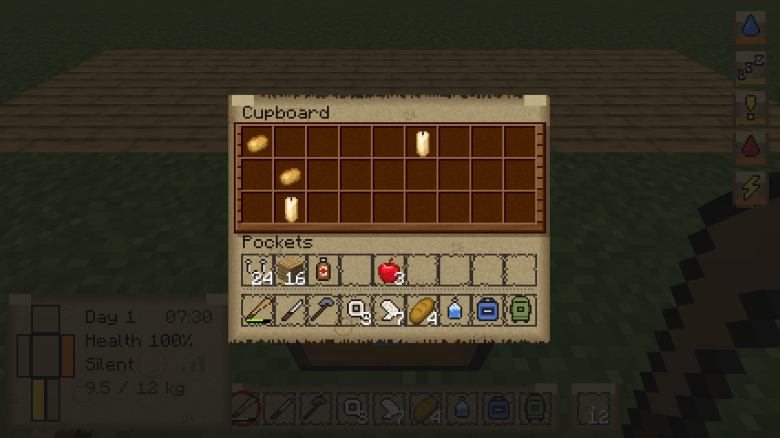
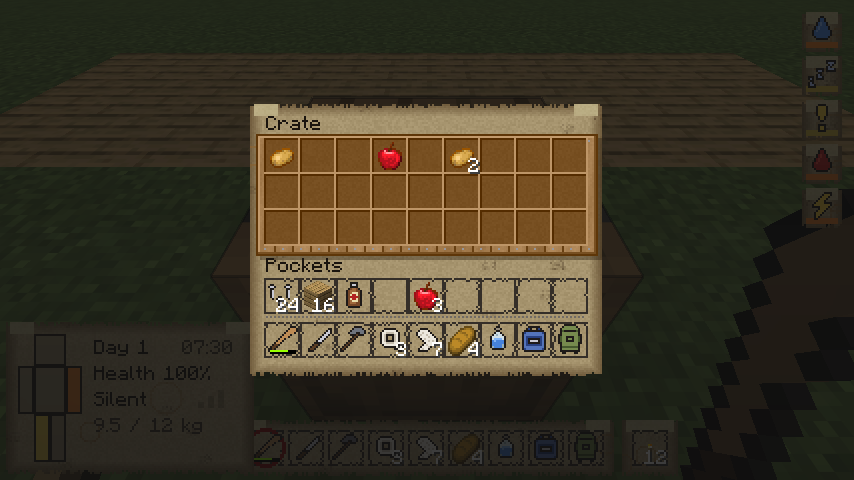
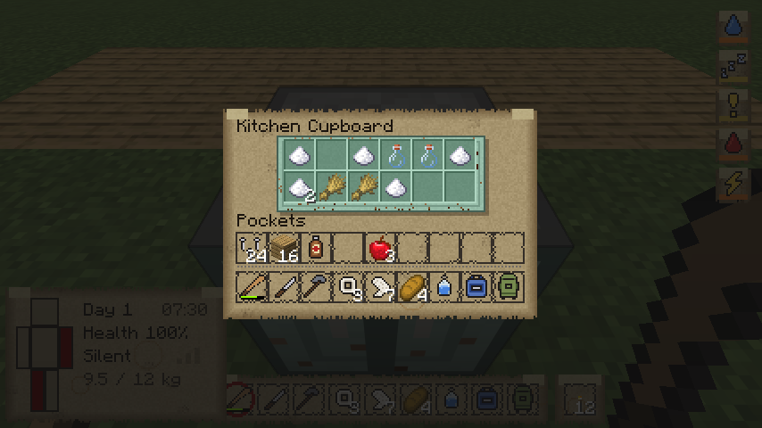
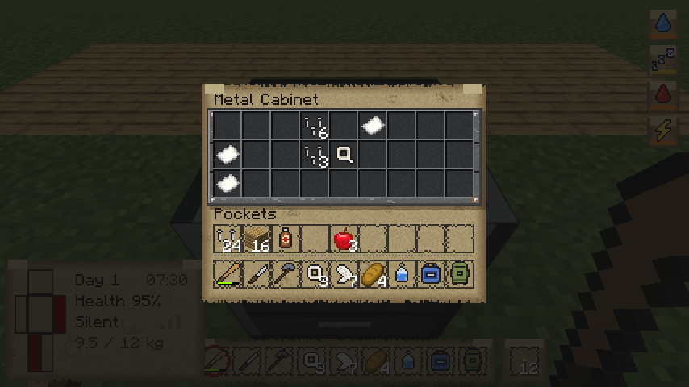
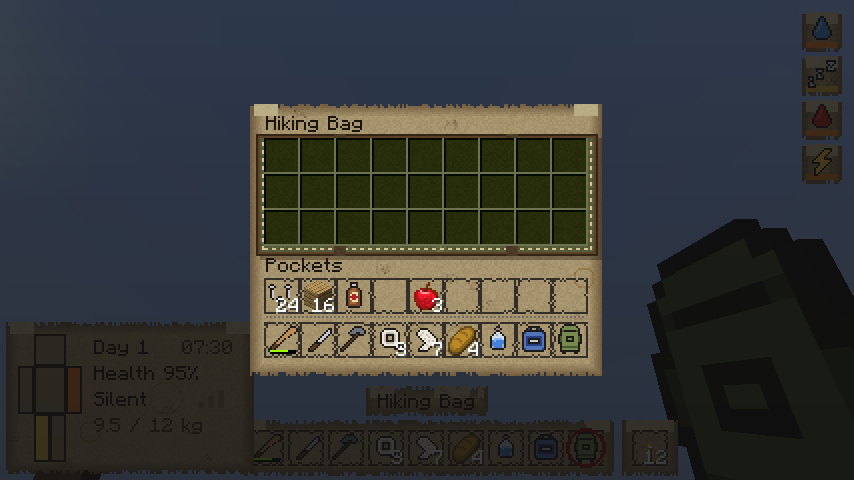

# The UI: dark paper

Every screen and the HUD look like pages torn from a survivor's notebook: dark, stained paper, ink
handwriting, a red marker for danger, pencil for the details. It replaces all of vanilla's look.
The style was picked from [mockups](mockups/) (`C-dark-paper.png`).

## HUD
See [HUD](HUD.md) for what each part shows. The status panel, the hotbar, the offhand slot and the
item name tag are paper; the selected slot is circled in red marker; moodles sit on small paper
tags that go from pencil-grey (level 1) to red (level 3) and flicker at level 4.

## Health panel (H)

A full page: the body doll, every wound in words (bites and lacerations in red marker), overall
health, carry weight and how you feel.

## Inventory: 18 slots

- **9 hotbar slots + 9 pockets.** That's all you can carry on your body. Vanilla's 27-slot backpack
  area is gone: the page just says *Need more room? Find a bag.*
- Picking things up only fills the hotbar and pockets; what doesn't fit stays on the ground.
- Items in an old world's locked slots move to a free pocket within a second, or drop at your feet.
- Armour slots, the offhand, the 2×2 crafting grid and the recipe book stay where vanilla has them.
- The weight you carry is written under the pockets (red when overloaded).
- Creative mode is unaffected.

## Containers: each has its own screen
Every container gets its own screen with its own material, and the same pockets and hotbar below.

| Container | Slots | Looks like | Where you find it | Loot |
|---|---|---|---|---|
| School bag | 9×2 | blue denim | item; sneak-right-click to wear | — |
| Hiking bag | 9×3 | olive canvas with stitching | item; sneak-right-click to wear | — |
| Cupboard (a chest) | 9×3 | wooden planks | vanilla chest | by room (kitchen, bedroom, workshop…) |
| Wardrobe (a double chest) | 9×6 | wooden doors | two chests side by side | by room |
| Crate (a barrel) | 9×3 | light wood, nailed | vanilla barrel | by room |
| **Fridge** | 6×3 | white enamel | new block | food, milk, boiled water, sometimes rotten |
| **Kitchen cupboard** | 6×2 | painted mint-green | new block | bread, cookies, bottles, sugar, rags, a knife |
| **Toolbox** | 5×2 | red steel | new block (small) | nails, hammer, crowbar, iron |
| **Metal cabinet** | 9×3 | grey office steel | new block | paper, books, torches, first aid, sometimes a machete or a hiking bag |

Chests and barrels are still vanilla blocks with vanilla contents (Arnis worlds are full of them);
only their screen changed. The four new blocks need a pickaxe (toolbox, fridge, metal cabinet) or an
axe (kitchen cupboard), keep their contents in the world when broken (they spill out), and can be crafted:

| Block | Recipe |
|---|---|
| Fridge | 8 iron ingots around a glass pane |
| Kitchen cupboard | 8 planks around an iron nugget |
| Metal cabinet | 8 iron ingots around an iron nugget |
| Toolbox | 2 iron nuggets over 3 iron ingots |

Like chests, new blocks placed by a player are never filled with loot. Ones placed by the map (or by
commands) get their loot the first time they're opened.

| | | |
|---|---|---|
|  |  |  |
|  |  |  |
|  |  |  |

## How it's made
- All textures (screens, HUD sprites, the inventory page and the new blocks) are generated by
  `python3 tools/textures/hudart.py export`. Change a colour in the `DarkJournal` style and
  re-export; the ink colours in code are in `PaperStyle.java`.
- `python3 tools/textures/hudart.py mockup <backdrop.png> <out dir> [paper|chosen]` renders the
  style mockups over a game screenshot (`BackdropClientTest` takes a clean one).
- The container layouts (columns × rows) live in `ContainerKind.java` and `KINDS` in `hudart.py`;
  keep them the same.

## Tests
- Server: `python3 tools/servertest/driver.py . tools/servertest/ui.txt run/ui.log` — 21 swords give
  18 in the inventory and 3 on the ground; an item in a locked slot moves to slot 0; each new container
  fills on first open; a broken fridge drops itself.
- Client: `UiClientTest` opens the health panel, the inventory and every container and screenshots them.
